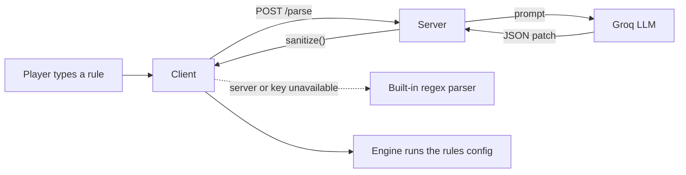

<div align="center">

# ♟ My Rules Chess

### Chess, but you write the rules.

Type a rule in plain Russian or English — *"the knight can teleport"*, *"the queen is invulnerable"* — and it changes the game **right now**, mid-match.

<p>
  
  
  
  
  
</p>

[Idea](#-the-idea) · [Features](#-features) · [Rule ideas](#-rule-ideas) · [Run locally](#-run-locally) · [Deploy](#%EF%B8%8F-deploy) · [How it works](#%EF%B8%8F-how-it-works) · [Limitations](#%EF%B8%8F-limitations)

</div>

<!-- Add a screenshot or GIF here once you have one:
<p align="center"></p>
-->

---

## 💡 The idea

Regular chess has one fixed rulebook. **My Rules Chess** starts from the familiar game and lets the players *rewrite the rulebook while playing*.

Each player can describe a new rule in a sentence. An AI-assisted parser (with a built-in fallback) turns the sentence into a small JSON config, and the chess engine simply follows that config. The result feels like a duel of "spells": you play chess, and every couple of moves you get to bend the game.

## 🎮 Features

| | |
|---|---|
| **Rules in plain language** | Describe a rule instead of editing configuration. Works in Russian and English. |
| **Custom movement** | Change directions and range, let pieces jump over others, or teleport to empty squares. |
| **Fantasy abilities** | Shooting, swapping places with an ally, explosions on capture, invulnerability, protection from neighbouring pieces. |
| **Rewrite the basics** | Pawn captures, promotion, castling, check and checkmate — and even *which piece decides the win*. |
| **Local play** | Against a lightweight bot, or two players on one device. |
| **Online play** | Private rooms with a 4-character code, reconnect support, draw offers, resignation, and rematch with swapped colours. |
| **Polished UI** | English / Русский (follows the browser language), light and dark themes, Cburnett piece set. |

### Rule changes, in short

- Rules can be set freely **before the first move**.
- During a game you can change them **on your own turn, once every two of your own moves**.
- Changing a rule **does not use up your move**.

## ✨ Rule ideas

Try typing these (Russian works too):

| Rule | What happens |
|---|---|
| `Bishop moves like a knight` | The bishop's movement is replaced. |
| `The queen can jump over pieces` | The queen ignores blockers. |
| `Pawns capture only straight ahead` | Pawn captures are rewritten. |
| `The queen is invulnerable` | The queen can't be captured. |
| `The bishop explodes when it captures` | Capturing also destroys neighbouring pieces. |
| `The knight can teleport once per game` | One teleport to any **empty** square; normal knight moves are kept. |
| `Pawns have guns` | Pieces can shoot without moving. |
| `No check or checkmate` | Win by capturing the king. |

> **Teleport note:** a teleport only lands on empty squares and never captures. This keeps it from "attacking" the king from everywhere, which would make every position checkmate.

Ideas the engine cannot express (freezing, resurrection, new piece types, extra turns…) are reported back to the player instead of being silently faked. See [Limitations](#%EF%B8%8F-limitations).

## 🧩 Project structure

```text
My-Rules-Chess/
├── myruleschess/
│   ├── client/
│   │   └── index.html      # UI, embedded engine, rule parser (fallback), local play, Yandex Games SDK hook
│   └── server/
│       ├── server.js       # HTTP API (/parse, /version) + WebSocket rooms
│       ├── engine.js       # Rules, move generation, game endings (shared logic)
│       └──package.json
└── README.md
```

- **Client:** a single file of HTML, CSS and vanilla JavaScript — no build step.
- **Server:** Node.js with the [`ws`](https://github.com/websockets/ws) library. The AI parser calls the Groq API; it is optional.

> ⚠️ **Keep the engine in sync.** `server/engine.js` is also embedded inside `client/index.html`. After changing one, apply the same change to the other.

## 🚀 Run locally

### Requirements

- Node.js **18+**
- A modern browser
- *(Optional)* a Groq API key for AI-assisted rule parsing

### 1. Start the server

```bash
cd myruleschess/server
npm install
npm start
```

It listens on port `8080`, or on `PORT` if set.

### 2. Point the client at it

In `myruleschess/client/index.html` find:

```js
const SERVER = 'wss://CHANGE-ME.onrender.com';
```

and change it for local development:

```js
const SERVER = 'ws://localhost:8080';
```

### 3. Serve the client

In a second terminal:

```bash
cd myruleschess/client
python -m http.server 5500
```

Open <http://localhost:5500>.

> The board, the bot and the built-in parser work without a backend. Online rooms and AI-assisted parsing need the server.

### 4. Enable the AI parser *(optional)*

**macOS / Linux**
```bash
export GROQ_API_KEY="your-groq-api-key"
npm start
```

**Windows PowerShell**
```powershell
$env:GROQ_API_KEY = "your-groq-api-key"
npm start
```

Optionally set `GROQ_MODEL` to choose the preferred model; the server falls back through several others automatically.

**Never commit your API key.** Keep it in environment variables only.

## ☁️ Deploy

### Backend (e.g. Render)

1. Create a **Web Service** connected to this repository.
2. **Root Directory:** `myruleschess/server`
3. **Build command:** `npm install` · **Start command:** `npm start`
4. Add `GROQ_API_KEY` as an environment variable (optional).
5. Put the service URL into `SERVER` in `client/index.html`, using the `wss://` scheme.

Check a deployment by opening `https://your-service.onrender.com/version`.

> **Free-tier note:** Render's free plan puts services to sleep when idle, so the first request after a pause can take 30–60 seconds. The client sends a wake-up request when the page opens.

### Client (static hosting / Yandex Games)

The client is one static file, so it works on GitHub Pages, Netlify, or similar. For an HTTPS page always use **WSS**, not WS.

For **Yandex Games**, add the backend's HTTPS and WSS origins to the game's Content Security Policy, otherwise online play and AI parsing will be blocked.

Further server notes: [`myruleschess/server/README.md`](myruleschess/server/README.md).

## ⚙️ How it works



- **Rules are data.** Everything the engine knows lives in a JSON config: which piece wins (`winPiece`), whether check exists, pawn behaviour, immunity, shields, and per-piece movement (`slide`, `jumps`, `leap`, `shoot`, `swap`, `blast`, limits, and so on).
  ```json
  { "pieces": { "N": { "jumps": "any", "jumpLimit": 1 } } }
  ```
- **The AI can't break the game.** Model output is only a *patch*; it passes through `sanitize()`, which accepts known fields only. Unsupported requests are returned as unsupported rather than imitated.
- **The server is the referee.** In online games every move is validated server-side with the same engine, so a modified client cannot cheat.
- **Local play** runs the engine entirely in the browser. The bot is a simple move-scoring heuristic with some randomness — not a strong engine.
- **Online play** uses WebSockets and four-character room codes. Players who disconnect can resume their seat for a short grace period.
- **Rate limits** protect the AI endpoint; when it is unavailable the game quietly uses the built-in parser.

## ⚠️ Limitations

- **Not every variant is expressible.** New piece types, extra turns, freezing, resurrection, board reshaping and time-based effects are not implemented.
- **The built-in parser is a subset.** It recognises common phrasings; the AI parser is far more flexible but needs the backend.
- **The bot is weak,** especially with unusual rules.
- **State is in memory.** Rooms and the parse cache disappear when the server restarts.
- **Draws are simple:** by agreement, repetition and bare kings. Positions like king + bishop vs king are not detected as dead draws.
- **Experimental.** Odd rule combinations can produce odd games — that's part of the fun, but report anything that looks like an engine bug.

## 🛠 Development notes

- No build step and no front-end dependencies; the only npm dependency is `ws`.
- A good regression check for engine changes is **perft** on the standard setup: depths 1–3 must give **20 / 400 / 8902** moves.
- When you add a new rule field, update all of these together: the engine, `sanitize()`, the AI prompt in `server.js`, the fallback parser in `index.html`, and the Russian and English UI strings.

## 📄 Credits

Piece artwork is based on the **Cburnett** set by Colin M. L. Burnett, used under the BSD licence; the notice is kept in the client source.

---

<div align="center">

Made for experimenting with chess — one rule at a time.

</div>
